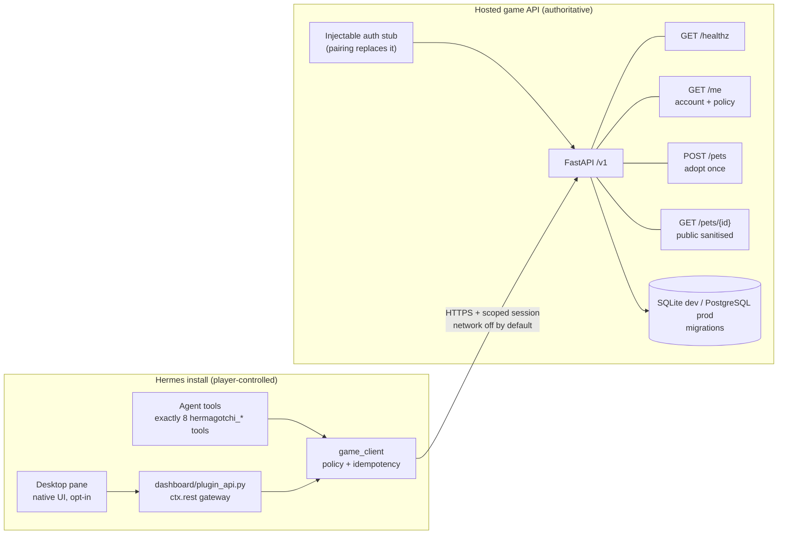

# Hermagotchi architecture (contracts-v1)

One Hermes plugin and one optional hosted game service. The plugin never owns
authoritative state; the server never receives Hermes prompts, memory or keys.

## Boundaries

- **Plugin side:** tool schemas, owner policy gates, idempotency keys, local
  client, optional dashboard proxy, Desktop rendering. No server secrets in
  Desktop code and no direct renderer calls with player tokens.
- **Server side:** identity, pet creation, appearance seeding, future combat,
  wallet/ledger, inventory, chat moderation and rankings. Every mutation is
  authenticated and ownership-checked server-side.
- **Contracts:** `shared/schema/manifest.json` freezes the 16 contracts-v1
  names and their minimal fixtures. `ruleset_version` is `battle-1`,
  `economy_version` is `economy-1`, asset pack is `launch-001`.

## This slice (HGT-W1-A)

Implemented: `/v1/healthz`, `/v1/me` with an injectable test-auth dependency,
`POST /v1/pets` (adopt once per account, server-generated `appearance_seed`,
species `byteblob|patchfox|nullgeist`) and `GET /v1/pets/{id}` (public
sanitised projection). Migrations create `accounts` and `pets` only. No wallet
writes, combat, shop or chat exist yet; they arrive as new ops/routes against
the same frozen contracts.

## Trust rules

- Chat and server text are untrusted display data, never governing prompts.
- The server never receives prompts, tool payloads, memory, OS usernames or
  arbitrary file paths.
- Appearance seeds are generated server-side; client-supplied seeds are ignored.
- Public pet payloads omit `account_id` and `care_updated_at`.
- Default owner policy is human mode, network off, autonomy off, chat off.
